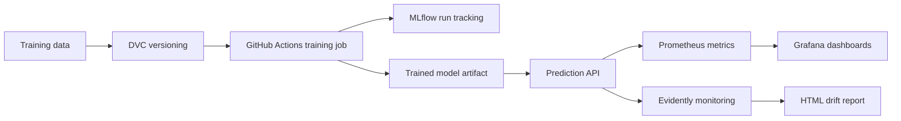

# MLOps Project

Use this repository as a **template** for your MLOps project. You will turn a notebook-based taxi trip-duration model into a reproducible MLOps workflow. You version training data with DVC, track runs with MLflow, automate training with GitHub Actions, serve predictions through an API, and monitor the system with Evidently, Prometheus, and Grafana.

The training notebook is included so you can start from the model used in the monitoring lesson. Keep your project small and use pull requests in your own repository to track your work, even when working alone.

## Learning Objectives

By the end of this repository, you should be able to:

- Convert notebook experimentation into reusable training code.
- Automate retraining with GitHub Actions.
- Version training data and model artifacts with DVC and MLflow.
- Serve a trained model through an API.
- Monitor model behavior, data quality and operational metrics with an observability stack.

## Learning Path

| File / Folder | Description |
|---|---|
| [**Project Description**](project-description.md) | Assignment brief, deliverables, and suggested milestones. |
| [**01 - Train an ML Model**](01-train-ml-model.ipynb) | Supplied taxi training notebook to refactor into reusable Python code. |

### Additional Folders and Files

| File / Folder | Description |
|---|---|
| [**assets**](assets/) | Visual aids referenced in the repository. |
| [**solution/README.md**](solution/README.md) | Optional reference workflow using Iris, DVC, MLflow, FastAPI, and monitoring. |
| [**solution/src**](solution/src/) | Data preparation, training, API, and report scripts for the reference solution. |
| [**solution/monitoring**](solution/monitoring/) | Prometheus configuration and provisioned Grafana dashboard. |
| [**solution/docker-compose.yaml**](solution/docker-compose.yaml) | The three-service reference stack. |
| [**.github/workflows/reference-solution.yaml**](.github/workflows/reference-solution.yaml) | Existing workflow that validates the reference pipeline and API. |
| [**pyproject.toml**](pyproject.toml) | Project configuration and dependencies. |
| [**uv.lock**](uv.lock) | Dependency lock file shared by the notebook and reference solution. |

The starter notebook comes from [mle-monitoring-in-ml](https://github.com/neuefische/mle-monitoring-in-ml/blob/2a805a98f7d6cf2266b291c0984c98f93bc6d9d3/01-train-ml-model.ipynb). The Iris solution illustrates the operational workflow; it is not a replacement for refactoring your taxi model.

## Project Flow



## Local Data Services

The notebook uses a local MLflow SQLite tracking store. The reference solution provides an API, Prometheus, and Grafana through Docker Compose:

| Service | Local URL |
|---|---|
| Notebook MLflow UI (when started) | <http://127.0.0.1:5000> |
| Reference prediction API / Swagger UI | <http://127.0.0.1:8000/docs> |
| Prometheus targets | <http://127.0.0.1:9090/targets> |
| Grafana | <http://127.0.0.1:3000> |

Grafana's initial local login is `admin` / `admin`. These services and default credentials are for local learning, not public deployment. Follow [solution/README.md](solution/README.md) to start the reference stack.

## Prerequisites

- **Docker Desktop**: required for the reference monitoring stack and for validating a containerized project. Follow the [installation instructions](https://docs.docker.com/get-docker/) if you do not have it yet. Make sure it is **installed and running** before starting the containers.

## Setup

> [!NOTE]
> Throughout these steps, text in angle brackets like `<repo-name>` is a **placeholder**. Replace it, including the `< >` brackets, with your own value. For example, `cd <repo-name>` becomes `cd mle-mlops-project`.

### 1. Use This Repository as a Template

Click **Use this template** on GitHub.

When creating the repository:

- Set yourself as the **Owner**
- Choose a repository name
- Disable **Include all branches**
- Click **Create repository**

> [!IMPORTANT]
> If you are working in pairs or groups, only **one person** should complete this step.

---

### 2. Add Collaborators (Pairs/Groups Only)

If working with teammates:

1. Open the repository on GitHub
2. Go to **Settings → Collaborators**
3. Add your teammates as collaborators
4. Share the repository link with your team

Teammates should accept the invitation before continuing.

---

### 3. Clone the Repository

Copy the SSH URL from the **Code** button on GitHub, then run:

```bash
git clone <copied-ssh-url>
```

The copied SSH URL will look like `git@github.com:<your-username>/<repo-name>.git`.

---

### 4. Move into the Project Folder and Install Dependencies

This project uses Python 3.13. The command below installs all dependencies and creates a virtual environment in `.venv/`.

```bash
cd <repo-name>
uv sync
```

The notebook and `solution/` share this environment. Do not create another environment inside `solution/`.

---

### 5. Create the Environment File

Copy the template once:

```bash
cp .env.example .env
```

Keep the default local tracking URI for the taxi notebook. The Iris reference solution manages its own tracking store in `solution/mlflow.db`.

> [!CAUTION]
> Never commit `.env`. It is git-ignored because environment files often hold secrets. Only `.env.example`, with placeholder or default values, belongs in the repository.

---

### 6. Open the Repository in VS Code

> [!NOTE]
> Make sure you open VS Code from the project root so it automatically detects the environment created by `uv sync`.

Launch VS Code in the project root folder:

```bash
code .
```

Then open [01-train-ml-model.ipynb](01-train-ml-model.ipynb) and select the Python environment created by `uv sync` as the kernel.

Run the notebook from the project root. Python commands use `uv run`, so the environment is selected automatically; no manual activation is needed.

## References & Further Reading

- [DVC Pipelines](https://dvc.org/doc/user-guide/pipelines): Version training inputs and reproduce dependent stages.
- [MLflow Model Registry Workflows](https://mlflow.org/docs/latest/ml/model-registry/workflow/): Register models, manage versions, and assign aliases.
- [Evidently Reports](https://docs.evidentlyai.com/docs/library/report): Compare reference and current datasets and export reports.
- [Prometheus Overview](https://prometheus.io/docs/introduction/overview/): Understand metric scraping, time series, and PromQL queries.
- [Grafana Provisioning](https://grafana.com/docs/grafana/latest/administration/provisioning/): Load data sources and dashboards from version-controlled files.

## Taxi MLOps - API and Monitoring

This project trains a model for NYC Green Taxi trip-duration
estimation and demonstrates an MLOps workflow with DVC, MLflow,
FastAPI, Prometheus, Grafana, and Evidently.

### Environment

Python 3.13 and uv are used for dependency management.

```bash
uv sync --locked
```

### Training

The training pipeline uses January 2024 NYC Green Taxi data.

```bash
uv run python -m src.train
```

The training step creates a local model artifact. The model file
is not committed to Git.

The dataset is tracked with DVC. The configured DVC remote is
local and may not be accessible on another machine. A fresh
environment must obtain the dataset from an accessible source
before training or monitoring.

### Prediction API

After training:

```bash
uv run uvicorn src.api:app --host 127.0.0.1 --port 8000
```

- `GET /health`: health check
- `POST /predict`: prediction
- `GET /metrics`: Prometheus metrics
- `/docs`: interactive FastAPI documentation

Successful prediction inputs are logged locally in SQLite.
The SQLite file is excluded from Git.

### Monitoring

Prometheus and Grafana can be started with:

```bash
docker compose up -d
```

Evidently drift monitoring:

```bash
uv run python -m src.monitor_api
```

A calibrated drift evaluation requires at least 5,000 recorded
API inputs. Insufficient data does not produce a drift decision.

### Tests

After creating the local model:

```bash
uv run python -m unittest tests.test_api tests.test_drift_gates -v
```

The independent end-to-end test is:

```bash
uv run python -m tests.e2e_independent_drift
```

It sends historical examples through a separate test API and
validates baseline and synthetic-drift scenarios.

The drift acceptance tests use small, committed JSON fixtures.
Large HTML reports and local runtime artifacts are not committed.

### Limitations

The project is a historical-replay demonstration, not a
production-ready pickup-time forecasting system. In particular,
trip distance is observed during the trip and is not necessarily
known at pickup time.

Calibration thresholds are provisional. Real-world drift
monitoring requires appropriate reference data and ongoing
validation. Prediction drift alone does not establish changes
in model accuracy.
